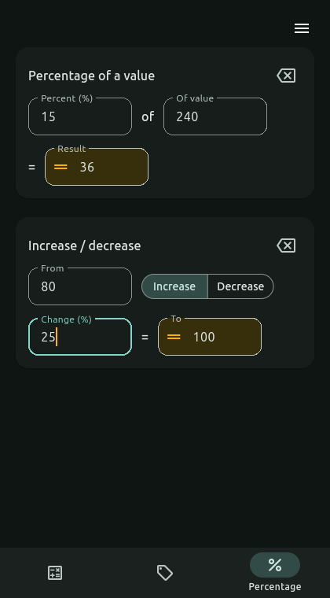

# EasyCalc

A small calculator for Android and Linux (AppImage, Flatpak), in English and Brazilian Portuguese.

- **Calculator:** keypad and keyboard input, editable expression, history.
- **Unit price:** enter price and quantity per item; the cheapest one is highlighted.
- **Percentage:** fill any two fields and the third is calculated.

License: GPL-3.0-or-later. App ID: `io.github.evandro777.EasyCalc`.




## Build

```sh
flutter pub get
flutter test
flutter run -d linux
flutter build apk --release      # Android (needs the Android SDK)
flutter build linux --release    # Linux bundle
```

## Release

1. Bump `version:` in `pubspec.yaml`, `appVersion` in `lib/about.dart` and `<release>` in the metainfo
   (`flutter test` checks they match).
2. Push a tag equal to that version, e.g. `v1.0.1`. `.github/workflows/release.yml` tests, builds the APK,
   AppImage and Flatpak, and publishes them. It refuses a tag that differs from `pubspec.yaml`.

### Android signing (required for tagged releases)

A tag build fails without these repository secrets, because a debug-signed APK can never be updated by a
properly signed one. Create the keystore once and keep the file safe (losing it means no more updates):

```sh
keytool -genkeypair -v -keystore release.jks -alias easycalc -keyalg RSA -keysize 2048 -validity 10000
base64 -w0 release.jks     # paste the output into the secret ANDROID_KEYSTORE_BASE64
```

Secrets: `ANDROID_KEYSTORE_BASE64`, `ANDROID_KEYSTORE_PASSWORD`, `ANDROID_KEY_ALIAS` (here `easycalc`), and
`ANDROID_KEY_PASSWORD` only if the key password differs from the keystore password. Manual workflow runs
without secrets still produce a debug-signed APK for testing.
