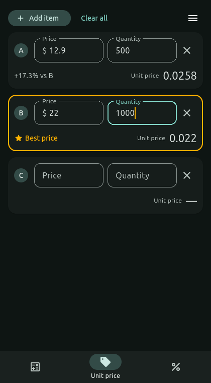

# EasyCalc

A small calculator for Android and Linux (AppImage, Flatpak), in English and Brazilian Portuguese.

- **Calculator:** keypad and keyboard input, editable expression, history.
- **Unit price:** enter price and quantity per item; the cheapest one is highlighted.
- **Percentage:** fill any two fields and the third is calculated.

License: GPL-3.0-or-later. App ID: `io.github.evandro777.EasyCalc`.




## Install

Downloads are on the [Releases](https://github.com/evandro777/EasyCalc/releases) page.

### Flatpak with automatic updates (recommended)

EasyCalc is not on Flathub. Every tagged release is also published to its own Flatpak remote, so `flatpak update`
(or your software centre) keeps it updated. The runtime comes from Flathub, so add that remote too:

```sh
flatpak remote-add --system --if-not-exists flathub https://dl.flathub.org/repo/flathub.flatpakrepo
flatpak remote-add --system --if-not-exists easycalc https://evandro777.github.io/EasyCalc/easycalc.flatpakrepo
flatpak install --system easycalc io.github.evandro777.EasyCalc
```

**`--system` vs `--user` matters for updates.** Linux Mint's Update Manager only checks system-wide Flatpaks. With a
`--user` install (use `--user` in all three commands), update by hand with `flatpak update --user`.

The remote is GPG-signed, but the public key is published from this same repository, so it is only as trustworthy
as the repository.

### Flatpak from file

Download `EasyCalc-<version>-x86_64.flatpak` and install it (needs the Flathub remote from above):

```sh
flatpak install --system ./EasyCalc-<version>-x86_64.flatpak
```

The bundle points to the remote above for later updates. For a first install, prefer the remote.

### AppImage

Download `EasyCalc-<version>-x86_64.AppImage` (needs GTK 3 on the system), then:

```sh
chmod +x EasyCalc-*-x86_64.AppImage
./EasyCalc-*-x86_64.AppImage
```

It does not update itself, but [AppImageUpdate](https://github.com/AppImageCommunity/AppImageUpdate) or
[Gear Lever](https://github.com/mijorus/gearlever) can update it, downloading only the changed parts.

### Android

Download `EasyCalc-<version>.apk` and open it. A sideloaded APK does not update itself.

## Build

```sh
flutter pub get
flutter test
flutter run -d linux
flutter build apk --release      # Android (needs the Android SDK)
flutter build linux --release    # Linux bundle
```

## Release

See [RELEASING.md](RELEASING.md) for how to publish a version and for the one-time signing and GitHub setup.
